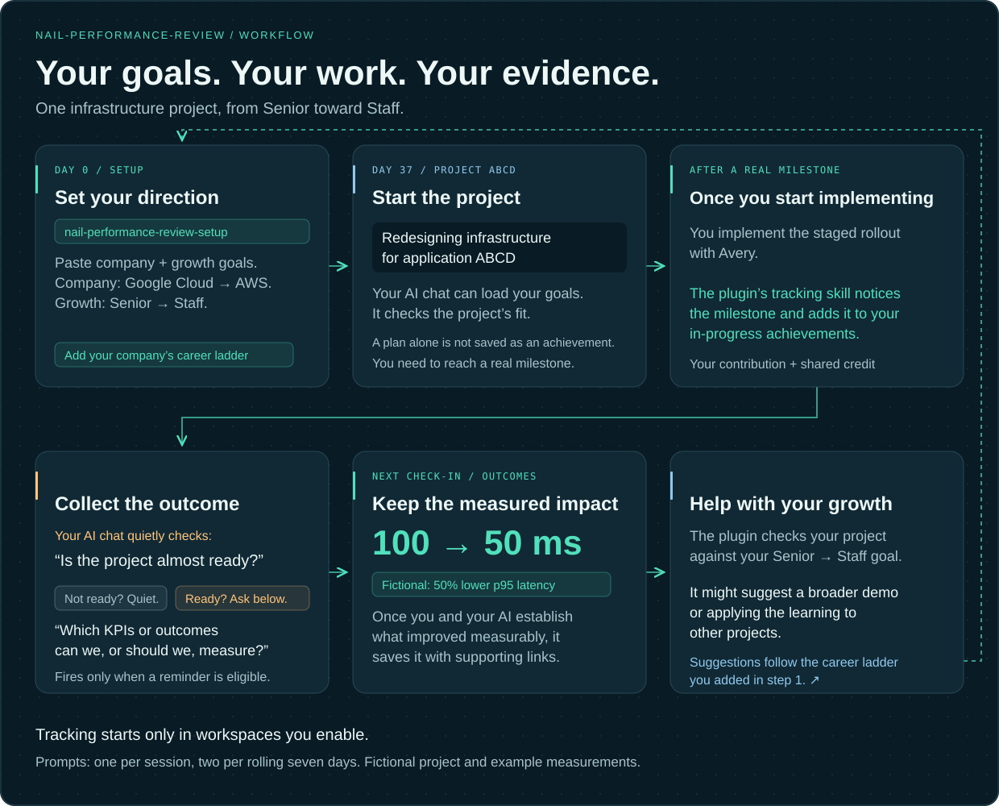

# nail-performance-review

Remember your achievements when the end-of-year review comes around.

## Who is it for?

| For whom | What it helps with |
|---|---|
| Individual contributors | Keep track of the work you do with AI tools, whether you’re an engineer, designer, product manager, accountant, or another role. It fits best when much of your work happens through AI agents or chats on your laptop. |
| Managers and team leads | Recommend it to your team so they document achievements and impact as they go. Make review season easier when people come to you with their contributions already collected. |

Your records stay in a folder on your laptop. Your chosen AI provider may process the notes your AI chat reads.

## Why I created it

I think we all want to get what we deserve based on our work and make our lives easier by collecting the evidence.

I created this plugin after spending about a week talking to my AI agent, trying to find the docs, projects, tickets, and chats I had worked on.

Just using AI at the end of the year isn’t enough. Chats can disappear, documents get lost, and some work never gets a ticket. Remember helping Kate learn a new tool during a quick 1:1 eight months ago? Did you ticket it? If not, that’s an example of mentoring and collaboration you might forget to mention in your review.

## How does it work?

| Step | What happens |
|---|---|
| 1. Start | Install the plugin, then say **“Help me set up my performance record.”** You can also choose `nail-performance-review-setup` from your AI tool’s skill menu. |
| 2. Give it some context | Start with your role, review period, and goals. Upload files or paste the text. Add development goals, promotion interests, your company’s career ladder, past reviews, or manager feedback when you have them. You don’t need all of these to begin. Use only information you’re authorized to store and share with your AI provider. |
| 3. Keep working | In a configured local AI tool, the plugin guides your AI chat to record real milestones as in-progress achievements. Planning alone isn’t saved as an achievement; you need to start making real progress. You can also say **“Record what we achieved.”** |
| 4. Check your priorities | Your AI chat checks the project against your saved yearly goals. If nothing matches, it asks whether you want to connect it to a goal, add an agreed goal, or work on it anyway. If it doesn’t benefit your priorities, is it something you want to spend your time on? |
| 5. Collect the impact | When the work in your chat suggests the project is nearly finished, your AI chat considers whether there are useful KPIs, before-and-after measurements, or feedback to collect. If the shared reminder limit allows, it asks what to collect and saves results with supporting links. |
| 6. Help with your growth | As a project wraps up, your AI chat checks your development goals and company expectations. It might suggest a broader demo, documentation, or applying the learning to another project. |

Goal-alignment, impact, and growth reminders share a limit of one per session and two per seven days across your configured tools. You can also snooze or dismiss them.

A career ladder describes what your company expects at different levels. You don’t need an upcoming promotion to start developing those skills. From what I’ve seen, people often show the skills of the next role before they get the title.

That’s it. Keep doing your work, and keep the useful evidence along the way.

The plugin doesn’t require an extra AI subscription. Use it with your current local Codex, Claude Code, Cursor, or Gemini CLI setup. Web chats use a manual handoff. Let me know what’s missing by [opening an issue](https://github.com/yaro-work/nail-performance-review/issues), sending a PR, or emailing stoiancee@gmail.com.

<picture>
  <source media="(max-width: 640px)" srcset="docs/assets/project-workflow-mobile.svg">
  
</picture>

*Example: migrate Google Cloud to AWS while growing from Senior toward Staff. In a workspace you enable for tracking, your AI chat uses your saved goals and the work you discuss to spot milestones and useful follow-ups. Measurements come from you or tools you authorize.*

## Install it

**Prefer help from your AI?** Give this README or repository link to your local AI coding tool and paste:

> Install nail-performance-review from https://github.com/yaro-work/nail-performance-review for the AI tools I use. Check whether Git and Node.js 22 or later are installed, and help me install missing prerequisites from their official sites. Keep my performance notes outside this repository, preserve my existing settings, and explain any trust steps I need to complete. Then help me set up my first goal and achievement.

**Prefer a few commands?** Install [Git](https://git-scm.com/downloads/) and [Node.js LTS, version 22 or later](https://nodejs.org/en/download) if you don’t have them. Node.js is the program that runs this plugin. Reopen your terminal after installation.

1. Download the plugin and create your record. By default, notes go in the `performance` folder inside your home folder.

   ```sh
   git clone https://github.com/yaro-work/nail-performance-review.git
   cd nail-performance-review
   node bin/nail.mjs init
   ```

2. Run the install command for **each AI tool you use**. These are alternatives; you don’t need all four.

   | Your AI tool | Run this command |
   |---|---|
   | Codex | `node bin/nail.mjs install --target codex` |
   | Claude Code | `node bin/nail.mjs install --target claude` |
   | Cursor | `node bin/nail.mjs install --target cursor` |
   | Gemini CLI | `node bin/nail.mjs install --target gemini` |

3. Run `node bin/nail.mjs doctor`. Complete your AI tool’s [trust or enablement steps](docs/install.md#connect-an-ai-tool), then start a new chat and say **“Help me set up my performance record.”**

For another notes folder, multiple employers, upgrades, or uninstalling, see the [installation guide](docs/install.md).

Automatic tracking is opt-in per workspace. The startup hook sends a short instruction and leaves your record on disk until your AI chat requests tracking context. See [how to enable it](docs/install.md#enable-automatic-tracking-for-a-workspace) or install with `--skills-only` for manual use.

## Prepare a review

Ask for an annual, mid-year, or custom review. The plugin gathers the saved evidence; your AI chat drafts a concise self-review with your contributions, collaborators, goals, and links. Ask for an offline HTML overview if you’d rather browse your achievements that way.

## Before you rely on it

- This is a personal recordkeeping tool, not an employee-monitoring or employment-decision system. Check generated claims, credit, and evidence before sharing. Missing records do not establish poor performance.
- Capture depends on your AI chat following the tracking instructions and having permission to save files. It doesn’t guarantee every achievement is saved. Check important milestones yourself.
- Your AI chat interprets progress from the current conversation. The plugin doesn’t independently monitor projects or dashboards, read unrelated chat histories, or invent missing measurements.
- Use your company’s expectations first. The [career examples](references/career-examples.md) are editable starting points, not promotion rules.
- Real Codex chats have saved achievements, corrected credit, prepared reviews, remembered a priority choice, and asked about project outcomes. Claude Code, Cursor, and Gemini CLI have automated installation and context tests; we haven’t verified these conversations in those tools.
- Records are local Markdown files, without encryption from the plugin. Your AI provider’s policies still apply to the notes it reads. Hosted chats without local file access need a [manual handoff](prompts/start.md).

Provided as is under the [MIT license](LICENSE), without warranties. No promotion or compensation outcome is guaranteed. Read the short [use notice](NOTICE.md) and [privacy guidance](docs/privacy.md).

See these docs only if you want to understand how this plugin was tested and developed in depth. Feel free to give the repository to your AI and ask questions that matter to you: [what we tested](docs/verification.md), [the repeatable evaluation](docs/assistant-evaluation.md), and [its results](docs/assistant-evaluation-results.md).
