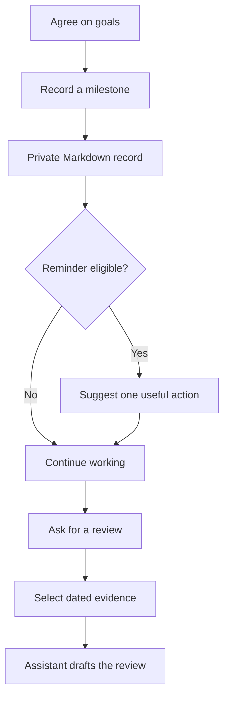
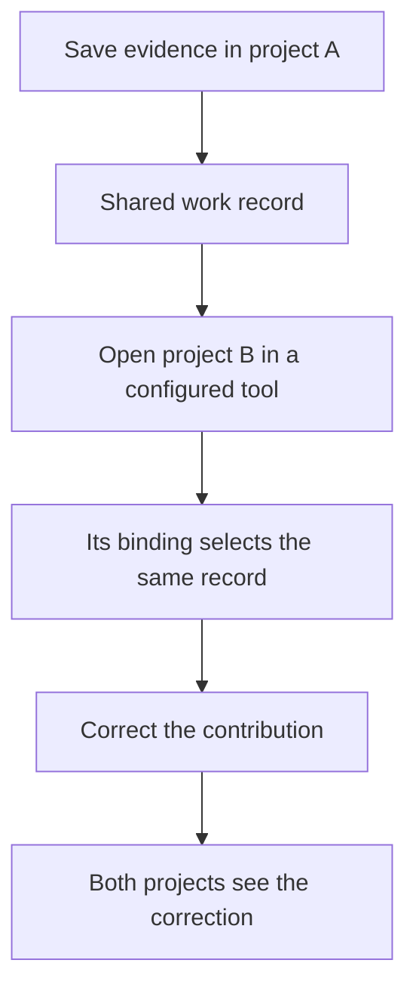
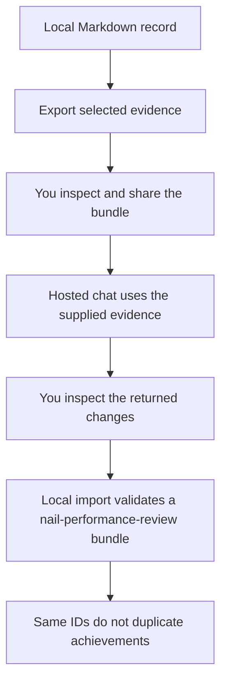

# How nail-performance-review fits into your work

For people deciding whether nail-performance-review fits their review process. Updated November 7, 2026.

These scenarios use fictional work. The command workflows run against real files in isolated test folders. A simulated adapter check does not prove an AI tool activated its hooks.

## The ABCD infrastructure example

The README illustration follows one project from agreed goals to a measured outcome. The setup skill is named `nail-performance-review-setup`; use your host's skill picker or ask "Help me set up my performance record."

The company goal is migrating Google Cloud to AWS; the personal goal is growing from Senior toward Staff. A plan alone is not saved as an achievement. Once implementation reaches a real milestone, the tracking skill can record your contribution and collaborators as in-progress evidence.

When a session starts, the plugin gives your AI chat your goals and tracking instructions. During meaningful work, your AI chat quietly checks whether the project appears nearly ready or complete. If useful evidence is missing and a reminder is eligible, it asks which outcomes to collect. It does not independently monitor project status or dashboards.

The example's 100 ms to 50 ms change means 50% lower latency. It uses the same 95th-percentile measure under comparable load and keeps a source link. These are fictional values, not results measured by nail-performance-review.

Measurements can be supplied by the person or obtained through tools the assistant is already authorized to use. An optional sharing suggestion can support a Staff growth goal when it fits the actual company ladder. Outcomes and sharing reminders still obey the shared budget, including the one-per-session limit.

<details>
<summary>Replay this example</summary>

```sh
node --test --test-name-pattern="ABCD milestones" tests/scenarios.test.mjs
node scripts/render-workflow.mjs
```

The CLI scenario checks stored goals and role, startup context, an in-progress milestone, sourced before/after values, reminder suppression, a separate eligible sharing reminder, and the resulting review and HTML. It does not evaluate whether an assistant will infer project readiness or inspect a dashboard.

The SVG generator produces wide and stacked versions in `docs/assets/`. It uses Node.js built-ins, with no runtime dependency.

</details>

## Keep useful evidence, then prepare a review

You add your role, review period, and agreed goals. Ask your assistant to save a meaningful milestone, then check the returned evidence ID and path. It records your contribution, collaborators, result, and links.

At review time, nail-performance-review selects the evidence for your dates. Your assistant writes the self-review; nail-performance-review's command-line program prepares the evidence and optional HTML.



The automated scenario checks a nonengineering profile, goal and project updates, saved evidence, missing measurements, a review packet, and an HTML file. Native Codex has also saved evidence and written a review. The conversational setup questions and follow-up quality still need evaluation.

## Continue in another project or tool

Bind two projects to the same named record: this saves each project's choice of performance folder. The [binding instructions](install.md#use-several-tools-or-records) show the command. Both adapters then resolve that folder. If you correct your contribution in one project, the other sees the correction.



Tests exercise all four adapter outputs against the same folder and confirm another employer's binding selects a different record. Actual cross-host continuation remains unverified because only Codex completed a native session on this laptop.

An explicit root or record name overrides a project binding. Without a binding, nail-performance-review selects the configured default. Check the printed record path before using a new work context.

## Use a hosted chat without local file access

Export the selected evidence, review it, and upload only what the chat needs. Use the [starter prompt and return instructions](../prompts/start.md). Inspect the returned nail-performance-review bundle before importing it. Ordinary prose needs review and local recording; it is not an importable bundle.

Corrections carry their original records, including records outside the selected dates. Inspect the entire bundle before sharing withdrawn claims or older work.



The automated scenario checks export, local import, and repeated import. It does not upload to a chat service or prove how that service handles your data.

## Replay the command scenarios

Run the scenario suite, then consult the [feature evidence](verification.md) for the checks behind each claim.

<details>
<summary>Command and test names</summary>

```sh
node --test tests/scenarios.test.mjs
```

| Test | Observable result |
|---|---|
| `scenario: a designer records work and prepares a review and HTML` | Profile, goal, project, and achievement appear in the dated packet and HTML. |
| `scenario: four adapters share a bound record and another employer stays separate` | Each adapter returns the same selected directory; another binding returns its own record. |
| `scenario: a correction follows the user across projects` | Context and the packet use the correction; original and corrected evidence files remain. |
| `scenario: reminders stay quiet across tools and honor user decisions` | Repeated, dismissed, snoozed, approved, and over-budget reminders are suppressed. |
| `scenario: a hosted-chat handoff imports once without copying company settings` | A validated evidence bundle imports once and a replay adds no records. |

</details>
